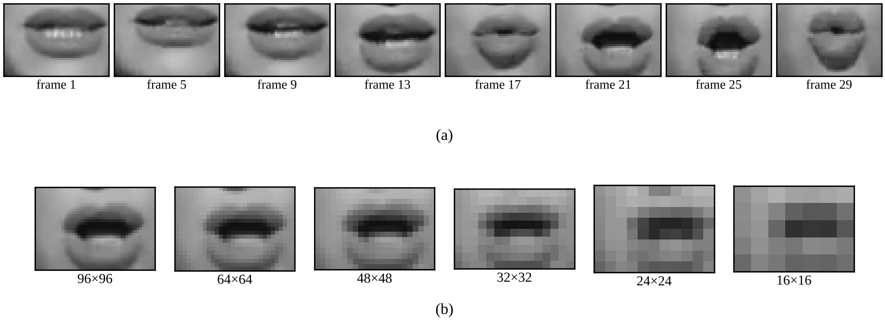

# Arabic Word-Level Lip Reading at Reduced Resolution: A Comparative Study of 2D and 3D Models

Code and results for the paper by **Saeed Alwadai** and **Sadam Al Azani** (King Fahd University of Petroleum and Minerals).

We study how reducing the mouth-region resolution affects Arabic word-level lip reading on a 23-word subset of
[LRW-AR](https://www.mdpi.com/2227-7080/13/1/26). Sixteen models from three families (small 3D-CNNs, 3D ResNet-18 and
ImageNet-pretrained 2D ResNet-18/50 with different temporal back ends) were trained at six resolutions
(96×96 to 16×16) with three random seeds each, giving **288 training runs**.

## Main findings
- Best model: pretrained ResNet-50 + TCN + temporal attention, **75.5 ± 0.4%** at 64×64 and 71.7 ± 1.0% at 48×48.
- Pretrained 2D ResNets drop sharply below 48×48; 3D models trained from scratch decline gradually
  (3D-CNN + spatiotemporal attention: 60.4% at 32×32; 3D ResNet-18: 54.8% at 16×16).
- Temporal modelling matters more than resolution: ResNet-50 alone reaches only 21.9% at 96×96, while adding a TCN gives 73.7%.

## Test accuracy (%), mean ± std over 3 seeds

| Model | 96×96 | 64×64 | 48×48 | 32×32 | 24×24 | 16×16 |
|---|---|---|---|---|---|---|
| 3D-CNN (baseline) | 13.5 ± 0.8 | 14.7 ± 1.0 | 14.3 ± 0.7 | 17.2 ± 0.3 | 15.1 ± 0.6 | 15.5 ± 0.7 |
| 3D-CNN + LSTM | 36.2 ± 2.6 | 45.1 ± 2.2 | 46.5 ± 2.8 | 44.8 ± 2.8 | 45.5 ± 2.4 | 35.7 ± 1.5 |
| 3D-CNN + GRU | 39.7 ± 1.8 | 51.8 ± 2.7 | 52.7 ± 5.1 | 49.4 ± 1.5 | 49.8 ± 1.6 | 43.4 ± 2.1 |
| 3D-CNN + temporal attention | 61.2 ± 2.2 | 64.6 ± 1.7 | 62.9 ± 1.2 | 54.5 ± 3.4 | 53.9 ± 5.3 | 45.3 ± 2.4 |
| 3D-CNN + spatiotemporal attention | 59.1 ± 1.8 | 61.5 ± 0.8 | 60.9 ± 2.1 | 60.4 ± 2.4 | 56.7 ± 2.7 | 34.9 ± 0.6 |
| 3D ResNet-18 | 63.5 ± 2.2 | 62.4 ± 0.6 | 63.8 ± 1.5 | 55.8 ± 2.8 | 47.7 ± 1.4 | 54.8 ± 1.4 |
| 3D ResNet-18 + temporal attention | 51.1 ± 4.3 | 57.3 ± 6.4 | 38.1 ± 5.0 | 40.9 ± 2.8 | 28.1 ± 11.3 | 8.3 ± 0.7 |
| ResNet-18 alone | 16.4 ± 0.5 | 14.6 ± 1.0 | 12.7 ± 1.6 | 11.1 ± 0.6 | 11.1 ± 0.5 | 9.2 ± 0.4 |
| ResNet-18 + TCN | 64.3 ± 0.7 | 54.8 ± 2.9 | 55.8 ± 3.0 | 46.3 ± 5.1 | 39.6 ± 1.9 | 18.3 ± 0.8 |
| ResNet-18 + TCN + attention | 71.5 ± 2.0 | 68.0 ± 1.6 | 65.5 ± 3.0 | 55.4 ± 5.3 | 43.8 ± 2.4 | 17.0 ± 3.2 |
| ResNet-18 + BiGRU + attention | 63.6 ± 0.8 | 60.6 ± 1.9 | 54.4 ± 3.6 | 46.0 ± 3.5 | 38.3 ± 0.6 | 18.8 ± 1.9 |
| ResNet-50 alone | 21.9 ± 0.3 | 19.2 ± 0.2 | 16.5 ± 0.7 | 11.0 ± 1.8 | 9.6 ± 1.6 | 7.9 ± 0.6 |
| ResNet-50 + TCN | 73.7 ± 0.3 | 70.2 ± 1.2 | 62.1 ± 0.3 | 42.7 ± 6.9 | 44.1 ± 7.7 | 19.4 ± 3.5 |
| ResNet-50 + temporal attention | 46.1 ± 1.5 | 41.3 ± 5.4 | 44.9 ± 2.4 | 24.0 ± 11.2 | 22.1 ± 9.9 | 9.6 ± 1.3 |
| ResNet-50 + TCN + attention | 75.0 ± 0.9 | 75.5 ± 0.4 | 71.7 ± 1.0 | 28.8 ± 10.7 | 28.5 ± 3.8 | 10.7 ± 1.6 |
| ResNet-50 + BiGRU + attention | 71.3 ± 0.8 | 73.3 ± 4.7 | 69.1 ± 2.4 | 42.8 ± 3.3 | 45.7 ± 1.8 | 13.9 ± 0.8 |

Chance level is 4.3% (23 classes). Precision, recall and F1 for every run are in `results/all_288_runs.csv`.

## Repository contents
| Path | Content |
|---|---|
| `RES200_experiments.ipynb` | Full experiment notebook: data loading, all 16 models, training, evaluation, tables and figures |
| `results/all_288_runs.csv` | Every run: model, seed, resolution, accuracy, precision, recall, F1, best epoch |
| `results/All_models_results_final.xlsx` | Mean ± std tables for accuracy, F1, precision and recall |
| `figures/` | Figures used in the paper |

## How to run
1. Open `RES200_experiments.ipynb` on Kaggle or Google Colab with a T4 GPU (Internet on).
2. Step 2 downloads the 23-word LRW-AR subset (pre-extracted 29 × 112 × 112 grayscale mouth crops).
3. Choose the models in Step 3 (`MODELS_TO_RUN`, `SEEDS`, `RESOLUTIONS`) and run all cells.
   Finished runs are saved after each run and skipped when the notebook is run again.

Training protocol: 30 epochs, batch size 16, AdamW with a one-cycle schedule (peak LR 1e-3, weight decay 1e-4),
mixed precision, gradient clipping 1.0; the best validation checkpoint is evaluated once on the 458 test clips.

## Dataset
LRW-AR was created by Daou et al. Please follow the dataset's own terms of use and cite:
Daou, S., Ben-Hamadou, A., Rekik, A. & Kallel, A. Cross-attention fusion of visual and geometric features for
large-vocabulary Arabic lipreading. *Technologies* 13, 26 (2025).

## Acknowledgements
The authors thank the SDAIA–KFUPM Joint Research Center for Artificial Intelligence (JRCAI) at King Fahd University of Petroleum and Minerals for its support.

## License
MIT (see `LICENSE`).
